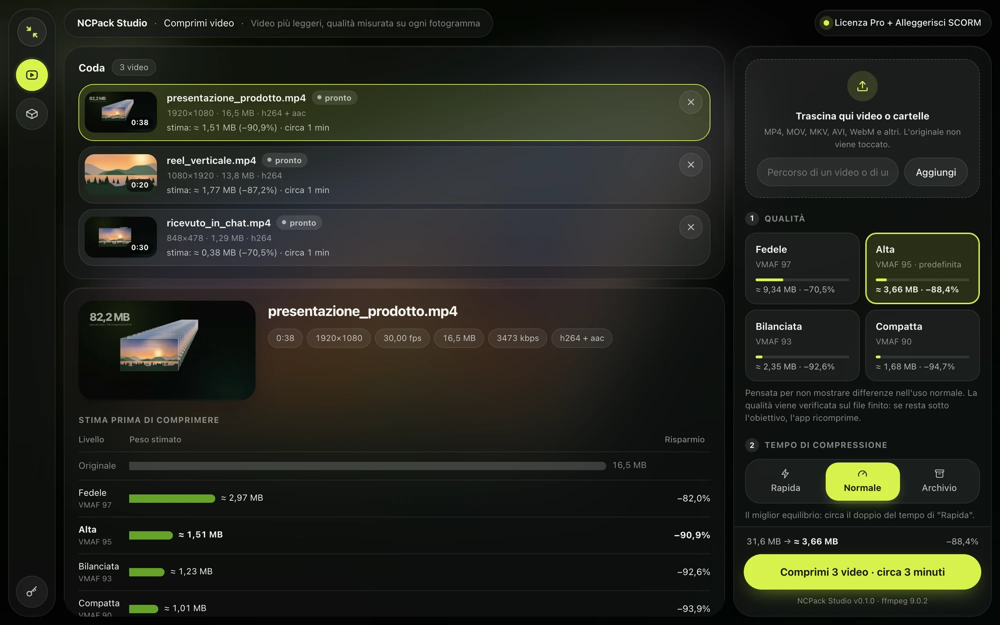
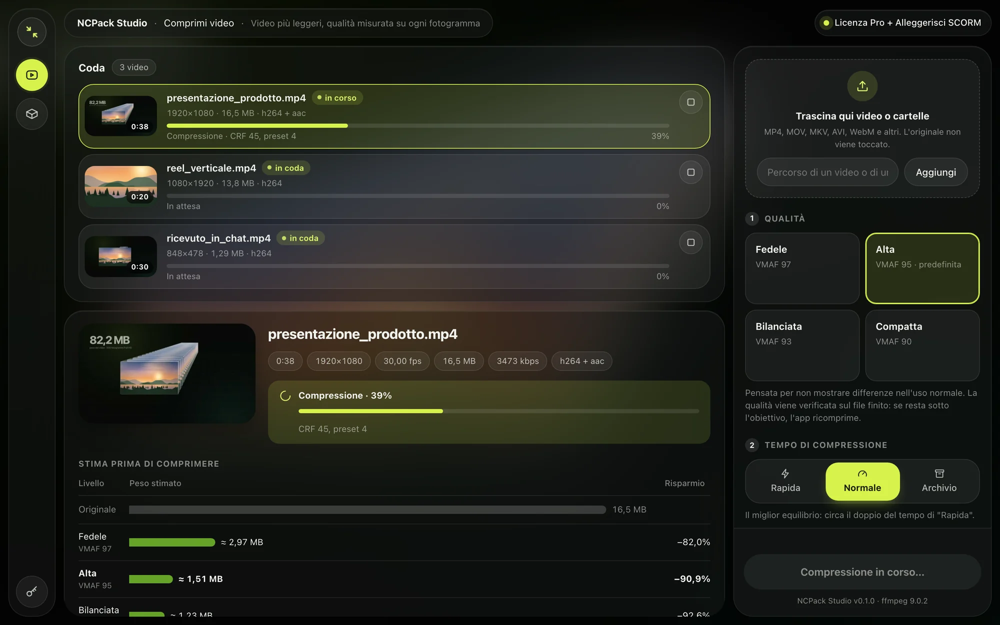
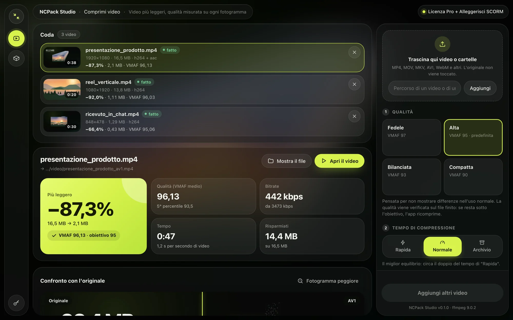
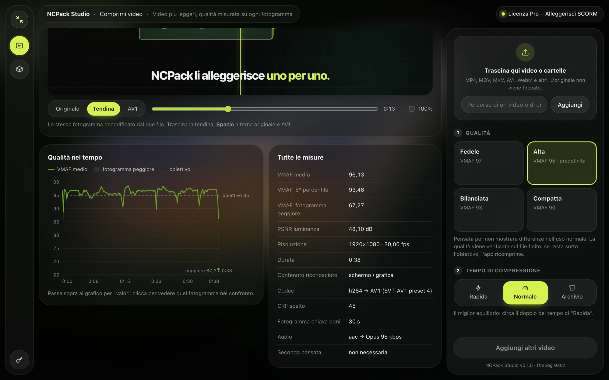
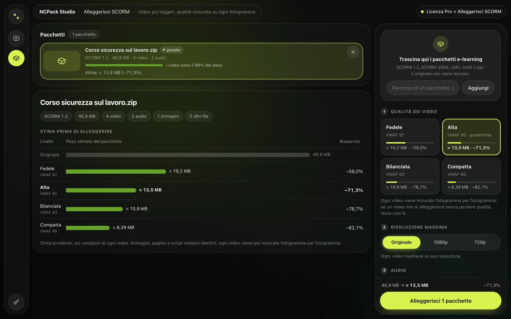
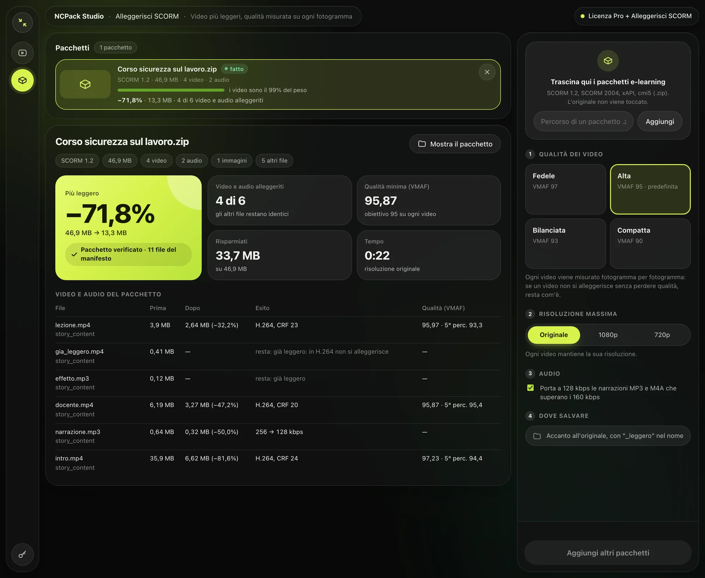
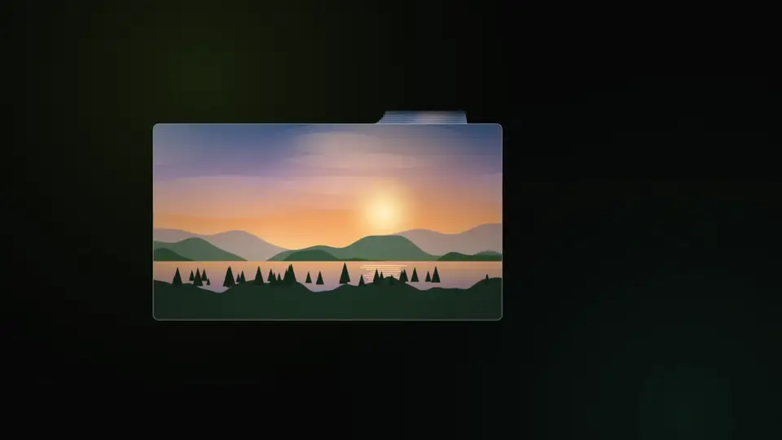

<a href="https://ncpack.roca.software/">
  <picture>
    <source media="(prefers-color-scheme: dark)" srcset="docs/banner-dark-it.svg">
    <source media="(prefers-color-scheme: light)" srcset="docs/banner-light-it.svg">
    
  </picture>
</a>

 

**[Sito](https://ncpack.roca.software/)** · **[Prova gratuita](https://ncpack.roca.software/#demo)** · **[Prezzi](https://ncpack.roca.software/#prezzi)** · **[Benchmark](BENCHMARKS.md)** · **[Segnala un problema](../../issues/new/choose)** · **[🇬🇧 English](README.md)**

 

NCPack Studio è un'app per computer che comprime i video in **AV1** e misura la qualità di **ogni
fotogramma** del file finito con [VMAF](https://github.com/Netflix/vmaf), la misura sviluppata da Netflix.
Se un video non può diventare più leggero senza perdere qualità, resta com'è: **non ricevi mai un file più pesante.**

  
   Trascini un video, vedi il peso prima di cominciare, ricevi un file verificato fotogramma per fotogramma.

 

## ✦ In breve

<table>
  <tr>
    <td align="center" width="25%"><h1>−59,5%</h1><b>Video Full HD da telefono</b> 82,2 → 33,3 MB · VMAF 96,65</td>
    <td align="center" width="25%"><h1>−71,8%</h1><b>Corso SCORM</b> 46,9 → 13,3 MB · funziona sulla piattaforma</td>
    <td align="center" width="25%"><h1>2,6%</h1><b>Errore mediano</b> della stima del peso, 14 video reali</td>
    <td align="center" width="25%"><h1>0 su 15</h1><b>File più pesanti</b> dell'originale, nei nostri test</td>
  </tr>
</table>

Misure al livello Alta (VMAF 95). Ogni video è diverso: con la prova gratuita le misuri sui tuoi file. Metodo: <a href="BENCHMARKS.md">BENCHMARKS.md</a>.

## ✦ Come funziona

<table>
  <tr>
    <td width="50%" valign="top">
      
      <h3>1 · Il peso lo sai prima</h3>
      Per ogni livello di qualità l'app prevede il peso finale e il tempo, comprimendo davvero dei
      brevi campioni e misurandoli.
    </td>
    <td width="50%" valign="top">
      
      <h3>2 · Comprimi una coda intera</h3>
      Trascina video o cartelle: MP4, MOV, MKV, AVI, WebM, HEVC 10 bit dei telefoni, ProRes.
      L'originale non viene mai toccato.
    </td>
  </tr>
  <tr>
    <td width="50%" valign="top">
      
      <h3>3 · Ricevi il file verificato</h3>
      Un MP4 in AV1 accanto all'originale. Se resta sotto l'obiettivo di qualità, l'app ricomprime.
      Se non è almeno il 5% più leggero, resta l'originale.
    </td>
    <td width="50%" valign="top">
      
      <h3>4 · Vedi ogni misura</h3>
      Qualità nel tempo, il fotogramma peggiore, la tendina tra originale e AV1 e il resoconto completo.
    </td>
  </tr>
</table>

### Quattro livelli, una sola misura

| Livello | Obiettivo VMAF | Per |
|:--|:--:|:--|
| **Fedele** | 97 | archivi e master |
| **Alta** · predefinito | 95 | uso di ogni giorno, pensato per non mostrare differenze |
| **Bilanciata** | 93 | web e social |
| **Compatta** | 90 | quando conta solo lo spazio |

## ✦ Alleggerisci SCORM servizio aggiuntivo

Per chi fa e-learning: prende un corso esportato da **Articulate, iSpring, Captivate** e altri
(SCORM 1.2, SCORM 2004, xAPI, cmi5) e lo restituisce più leggero, con gli stessi file, nomi e ordine.

<table>
  <tr>
    <td width="50%"></td>
    <td width="50%"></td>
  </tr>
  <tr>
    <td>Analisi e stima del risparmio gratuite, prima di comprare.</td>
    <td>46,9 MB → 13,3 MB. I video restano H.264: si vedono ovunque, Safari compreso.</td>
  </tr>
</table>

## ✦ Fatto per fidarsi

| | |
|:--|:--|
| 🔒 **Sul tuo computer** | Video e corsi non vengono caricati da nessuna parte. La rete serve solo per la licenza. |
| 📏 **Misurato, non stimato a occhio** | VMAF su ogni fotogramma del file finito: media, 5° percentile, fotogramma peggiore. |
| 🪶 **Mai più pesante** | Un video già compresso al massimo, come quelli di WhatsApp, resta com'è. |
| 🗂️ **L'originale non si tocca** | Il nuovo file nasce con un nome provvisorio e prende il suo nome solo dopo la verifica. |
| ⏱️ **Tempo prevedibile** | La stima dice quanto ci vorrà. Il computer non va in stop durante la compressione. |
| 🎞️ **Ogni formato** | 8 e 10 bit, frame rate variabile, video verticali, audio 5.1, più lingue, sottotitoli. |

   
  
   Il film del sito, disegnato fotogramma per fotogramma e compresso da NCPack Studio stesso: <b>da 369 MB senza perdita a 2,78 MB in AV1, VMAF 97,35.</b> · <a href="https://ncpack.roca.software/#film">Guardalo intero</a>

## ✦ Come averlo

1. Richiedi la **[prova gratuita di 7 giorni](https://ncpack.roca.software/#demo)**: chiave e link per il download arrivano per email. Nessuna carta.
2. Installa NCPack Studio: **macOS 12+ su Apple silicon** o **Windows 64 bit**.
3. Incolla la chiave in **Licenza**. Fatto.

Finita la prova l'app resta utilizzabile nella versione gratuita (livello Alta, velocità Rapida, un video alla volta).

| Piano | Prezzo | |
|:--|:--:|:--|
| **Prova gratuita** | 0 € | tutte le funzioni per 7 giorni |
| **Personal** | 29 € una tantum | 1 computer, 1 anno di aggiornamenti |
| **Pro** | 59 € una tantum | 3 computer (anche macOS e Windows insieme), 2 anni di aggiornamenti |
| **Alleggerisci SCORM** | 149 € all'anno o 19 € a pacchetto | pacchetti illimitati, tutto sul tuo computer |

Nessun pagamento online: [scrivici](https://ncpack.roca.software/#demo) e ci accordiamo su pagamento e fattura.

## ✦ Problemi e idee

Hai trovato un problema o ti manca una funzione? **[Apri una segnalazione](../../issues/new/choose)**.
Non allegare mai video o corsi che non puoi condividere pubblicamente: descrivili (formato, risoluzione,
durata, da dove arrivano) oppure mandaci un esempio per email.

 

  © 2026 NCPack Studio · ROCA Software. Tutti i diritti riservati. 
  Questo repository ospita documentazione, benchmark e segnalazioni; il codice sorgente dell'app non è pubblicato.

