<a href="https://ncpack.roca.software/en">
  <picture>
    <source media="(prefers-color-scheme: dark)" srcset="docs/banner-dark.svg">
    <source media="(prefers-color-scheme: light)" srcset="docs/banner-light.svg">
    
  </picture>
</a>

 

**[Website](https://ncpack.roca.software/en)** · **[Free trial](https://ncpack.roca.software/en#demo)** · **[Pricing](https://ncpack.roca.software/en#prezzi)** · **[Benchmarks](BENCHMARKS.md)** · **[Report a bug](../../issues/new/choose)** · **[🇮🇹 Italiano](README.it.md)**

 

NCPack Studio is a desktop app that compresses videos to **AV1** and measures the quality of **every frame**
of the finished file with [VMAF](https://github.com/Netflix/vmaf), the metric developed by Netflix.
If a video can't get lighter without losing quality, it stays as it is: **you never get a heavier file.**

  
   Drop a video, see the size before you start, get a file verified frame by frame.

 

## ✦ At a glance

<table>
  <tr>
    <td align="center" width="25%"><h1>−59.5%</h1><b>Full HD phone video</b> 82.2 → 33.3 MB · VMAF 96.65</td>
    <td align="center" width="25%"><h1>−71.8%</h1><b>SCORM course</b> 46.9 → 13.3 MB · works on the LMS</td>
    <td align="center" width="25%"><h1>2.6%</h1><b>Median error</b> of the size estimate, 14 real videos</td>
    <td align="center" width="25%"><h1>0 / 15</h1><b>Files heavier</b> than the original, in our test set</td>
  </tr>
</table>

Measured at the High level (VMAF 95). Every video is different: with the free trial you measure it on your own files. Method: <a href="BENCHMARKS.md">BENCHMARKS.md</a>.

## ✦ How it works

<table>
  <tr>
    <td width="50%" valign="top">
      
      <h3>1 · Know the size before you start</h3>
      For each quality level the app predicts the final size and the time it will take, by actually
      compressing short samples and measuring them.
    </td>
    <td width="50%" valign="top">
      
      <h3>2 · Compress a whole queue</h3>
      Drop videos or folders: MP4, MOV, MKV, AVI, WebM, 10-bit HEVC from phones, ProRes.
      The original is never touched.
    </td>
  </tr>
  <tr>
    <td width="50%" valign="top">
      
      <h3>3 · Get a verified file</h3>
      An AV1 MP4 next to the original. If it falls short of the quality target, the app compresses
      again. If it isn't at least 5% lighter, the original is kept.
    </td>
    <td width="50%" valign="top">
      
      <h3>4 · See every measurement</h3>
      Quality over time, the worst frame, a side-by-side wipe between original and AV1, and the full
      report.
    </td>
  </tr>
</table>

### Four levels, one measure

| Level | VMAF target | Best for |
|:--|:--:|:--|
| **Faithful** | 97 | archives and masters |
| **High** · default | 95 | everyday use, designed to show no difference |
| **Balanced** | 93 | web and social |
| **Compact** | 90 | when only space matters |

## ✦ SCORM Lightener add-on

For e-learning teams: takes a course exported from **Articulate, iSpring, Captivate** and others
(SCORM 1.2, SCORM 2004, xAPI, cmi5) and hands it back lighter, with the same files, names and order.

<table>
  <tr>
    <td width="50%"></td>
    <td width="50%"></td>
  </tr>
  <tr>
    <td>Free analysis and savings estimate, before buying anything.</td>
    <td>46.9 MB → 13.3 MB. Videos stay H.264 so they play everywhere, Safari included.</td>
  </tr>
</table>

## ✦ Built to be trusted

| | |
|:--|:--|
| 🔒 **On your computer** | Videos and courses are never uploaded. The network is used only for the licence. |
| 📏 **Measured, not guessed** | VMAF on every frame of the finished file: mean, 5th percentile, worst frame. |
| 🪶 **Never heavier** | A video already compressed to the limit, like WhatsApp ones, stays as it is. |
| 🗂️ **The original stays untouched** | The new file is written under a temporary name and renamed only after the check. |
| ⏱️ **Predictable time** | The estimate tells you how long it takes. The computer won't sleep while compressing. |
| 🎞️ **Every format** | 8 and 10 bit, variable frame rate, vertical video, 5.1 audio, multiple languages, subtitles. |

   
  
   The website film, drawn frame by frame and compressed by NCPack Studio itself: <b>369 MB lossless → 2.78 MB in AV1, VMAF 97.35.</b> · <a href="https://ncpack.roca.software/en#film">Watch it in full</a>

## ✦ Get it

1. Request the **[free 7-day trial](https://ncpack.roca.software/en#demo)**: the key and the download link arrive by email. No card.
2. Install NCPack Studio: **macOS 12+ on Apple silicon** or **Windows 64-bit**.
3. Paste the key under **Licenza**. That's it.

After the trial the app keeps working as the free version (High level, Fast speed, one video at a time).

| Plan | Price | |
|:--|:--:|:--|
| **Free trial** | €0 | every feature for 7 days |
| **Personal** | €29 one-off | 1 computer, 1 year of updates |
| **Pro** | €59 one-off | 3 computers (macOS and Windows mixed), 2 years of updates |
| **SCORM Lightener** | €149 / year or €19 per package | unlimited packages, all on your computer |

No online checkout: [write to us](https://ncpack.roca.software/en#demo) and we agree on payment and invoice.

> [!NOTE]
> The app's interface is in Italian for now.

## ✦ Bugs and ideas

Found a bug or missing a feature? **[Open an issue](../../issues/new/choose)**.
Please never attach videos or courses you can't share publicly: describe them (format, resolution,
duration, where they come from) or send a sample by email.

 

  © 2026 NCPack Studio · ROCA Software. All rights reserved. 
  This repository hosts documentation, benchmarks and the issue tracker; the app's source code is not published.

